# WWE SmackDown vs. Raw 2009 — native PC, Linux & Steam Deck

The Xbox 360 version of **WWE SmackDown vs. Raw 2009**, recompiled to run natively on Windows, Linux
and the Steam Deck: no emulator, **60 fps**, up to **4K**.

**The goal is simple: bring the game back so people can play it again, natively on PC at 60 fps.**
Out of the box it's the same game you remember, with no roster changes or reworked gameplay: only
what it needs to run well on today's hardware. Mods are up to you ([Mods](#mods)).

> **You need your own copy of the game.** It runs from a disc image (`.iso`) of your own SvR 2009
> disc. None of the disc's files are in this project or its downloads, and it does not condone
> piracy: please buy the game.
>
> **Version 3.0, still updated.** Run into a problem?
> [Open an issue](https://github.com/nefariousjosiah/WWE-SVR2009-RECOMP/issues) with `game.log` from
> the game's folder, your graphics card and a screenshot.

## Showcase

<p align="center">
  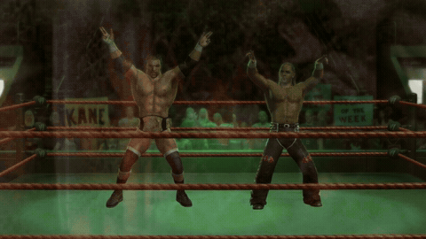
  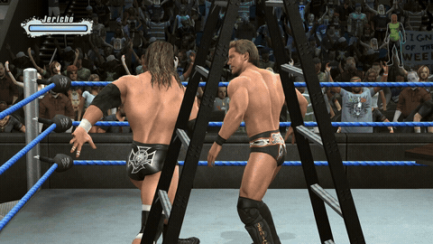
  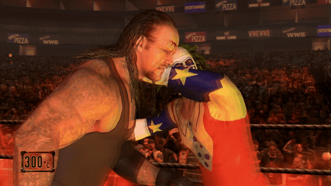
  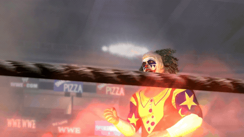
  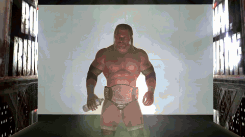
  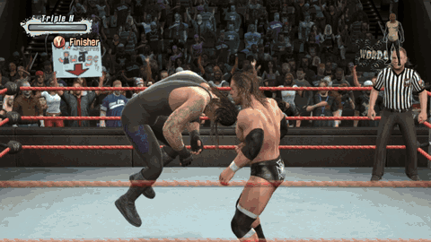
  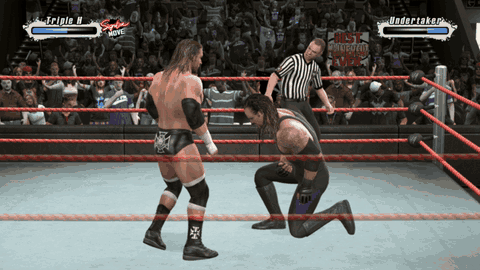
  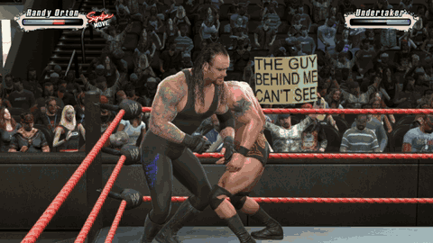
  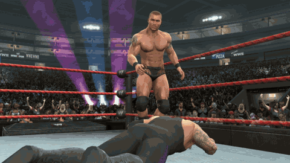
</p>

## Features

- **Native, not emulated:** the game's own code is recompiled for PC and drawn by a native renderer,
  Direct3D 12 on Windows and Vulkan on Linux and the Steam Deck.
- **60 fps,** using the game's own 60 fps mode so everything plays at the right speed, Road to
  WrestleMania cutscenes too (with their captions in sync).
- **480p up to 8K:** Auto picks 1440p on 1080p and 1440p screens, 4K on 4K screens and 720p on the
  Steam Deck; 480p helps weak graphics cards. The console's edge blur and its background blur (depth
  of field) are off for a sharp image; both are settings.
- **Smooth on lower-end PCs too:** no first-time stutters, and far less work per frame.
- **Matches load in about 20 seconds** instead of nearly a minute.
- **Play in your language:** English, Español, Français, Deutsch or Italiano.
- **Your own entrance music** ([User Playlist](#your-own-entrance-music-user-playlist)) and
  **your own DLC superstars** ([DLC](#dlc-optional)).
- **Mods,** such as yumboy11's **SVR09+** ([Mods](#mods)): extract them into the `mods` folder and
  switch them on or off in the game. A mod with its own save never touches yours.
- **Updates from inside the game,** only when you choose to; your saves are kept and backed up.
- **Controllers:** Xbox, PlayStation, Switch Pro and the Steam Deck's own.

<p align="center">
  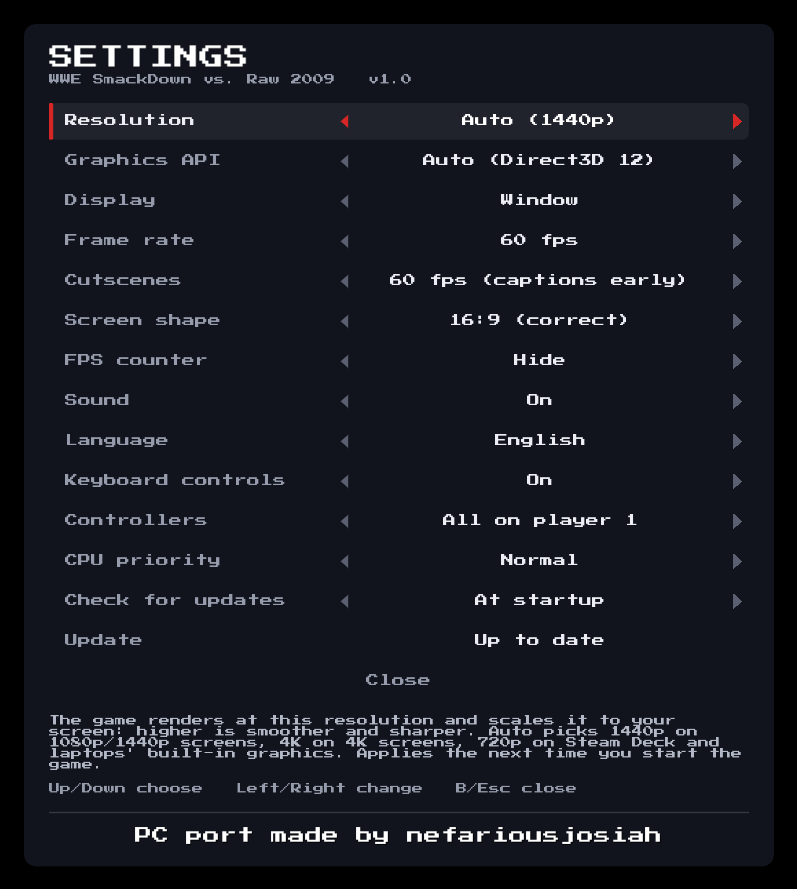
</p>

## Windows: install and play

1. Download **`SVR2009-NATIVE.zip`** from
   [Releases](https://github.com/nefariousjosiah/WWE-SVR2009-RECOMP/releases) (under *Assets*, not
   *Source code*).
2. Extract it to a folder of its own, for example `C:\Games\SVR2009-NATIVE` (not inside
   `Program Files`).
3. Copy your `.iso` into that folder, next to `svr2009.exe`.
4. Run **`svr2009.exe`**. If Windows warns, click *More info* > *Run anyway* (the program isn't
   code-signed).

**In game:** **F1** (or **Back + Start** on a controller, **Share + Options** on PlayStation) opens
the settings menu, and **F2** shows or hides the FPS counter. Your saves are in the `userdata`
folder: back it up to keep your career and created superstars.

You need Windows 10 or 11 (64-bit), a graphics card with Direct3D 12 or Vulkan (AMD, NVIDIA or
Intel, with a recent driver) and the USA / Europe release of the game (title ID `54510826`, media
ID `7AFA4596`, about 7.3 GB).

<details>
<summary><b>Settings, controllers and keyboard</b></summary>

- **The settings menu:** resolution (Auto, 480p, 720p, 1080p, 1440p, 4K, 8K), graphics API (Auto, Direct3D 12,
  Vulkan), fullscreen or window, 60 or 30 fps, **Screen shape**, **Edge blur**, **Background blur**, FPS counter, sound,
  **Language**, **Unlock everything**, keyboard controls, **Controllers**, CPU priority and updates.
  Saved in `svr2009.toml`.
- **Language:** the game's text and menus in English, Español, Français, Deutsch or Italiano (the
  commentary is English only, as on the disc). Pick one and press A twice to restart straight into it.
- **Unlock everything:** every superstar, arena, attire and other reward is available. Best treated
  as permanent: switching it off brings back your own progress, but rewards you earn while it's on
  are not saved. DLC you haven't added stays out.
- **Screen shape (experimental):** 16:10 (Steam Deck, many laptops), 21:9 and 32:9 (ultrawide).
  The whole game fills the screen: matches, entrances and cutscenes show more of the arena, nothing
  stretched; menu backgrounds reach the edges while text and panels keep their shape.
- **Controllers:** plug yours in before starting. By default every controller controls player 1; for
  **local multiplayer**, set **Controllers** to **Separate players**.
- **Disc image somewhere else?** If there's no `.iso` in the folder, the game asks for one the first
  time and remembers it.
- **Keyboard controls** are included but not tested yet (a controller is recommended). The default
  layout (rebind with **F4** in game):

| Controller | Keyboard | | Controller | Keyboard |
|---|---|---|---|---|
| A | Space / ; | | Left stick | W A S D |
| B | Backspace / ' | | Right stick | Arrow keys |
| X | L | | D-pad | Shift + arrow keys |
| Y | P | | LB / RB | 1 / 3 |
| Start | Enter / X | | LT / RT | Q / E |
| Back | Tab / Z | | Stick presses | F / K |

Shift, Ctrl and Alt work as buttons too (for example Shift to run). A key bound on its own like
that is no longer a modifier, so if you bind Shift, give the D-pad other keys.

</details>

## Linux and Steam Deck (Proton): install and play

The Windows release runs through Proton, Steam's compatibility layer: 720p at 60 fps on the Deck.

1. In **Desktop Mode**, download `SVR2009-NATIVE.zip`, extract it to a folder of its own (for example
   `/home/deck/Games/SVR2009-NATIVE`) and copy your `.iso` next to `svr2009.exe`.
2. In Steam: *Games* > *Add a Non-Steam Game to My Library...* > *Browse...*, set the file type to
   *All files* and pick `svr2009.exe`.
3. Right-click it > *Properties...* > *Compatibility*, tick *Force the use of a specific Steam Play
   compatibility tool* and choose **Proton Experimental**.
4. Back in **Game Mode**, start it from *Library* > *Non-Steam*.

<details>
<summary><b>More for the Steam Deck and Linux</b></summary>

- **Copying from your PC:** a USB stick must be **exFAT or NTFS** (the disc image is bigger than
  FAT32's 4 GB limit). A microSD card works too.
- **Other Linux PCs:** the same steps in Steam's desktop client, with up-to-date Vulkan drivers.
- **The first start** takes a little longer while Proton sets itself up.
- **Settings:** press **View + Menu** together. To use a back button instead: the game's
  *Controller settings* > *Edit Layout* > *Back Grip Buttons* > **L4** > *Keyboard* > **F1**.
- **Black bars:** the game is 16:9 and the Deck's screen 16:10; *Screen shape* > *16:10* in the
  settings menu fills it without stretching (experimental), *Stretch to fill* by stretching.
- **Quit** with the Steam button > *Exit game*. You can rename the shortcut (*WWE SmackDown vs. Raw
  2009*) and set its artwork in its properties.

</details>

## Updating

Open the settings menu, go to **Update** and press **A** to see what's new, **A** again to install,
then **Restart now**. Your `userdata` (saves, created superstars, installed DLC), settings, `dlc`,
`music`, `mods` and `userdata-mods` folders and disc image are kept, and your saves (the mods' own
saves too) are also copied to `save_backups` first; if
anything goes wrong, the version you had is put back. **Check for updates: Off** keeps the game
offline (the check only asks GitHub for the latest release). Coming from v0.4 or older? Download the
new zip once by hand.

## DLC (optional)

Your own Roster Update packs work: new superstars, their entrances and an extra costume. Copy the
package files from your Xbox 360 (the files with long names like `9FBE32EF4CDA...` in
`Content\0000000000000000\54510826\00000002\`, copied off with a USB stick and a tool such as Horizon
or Velocity) into the `dlc` folder next to `svr2009.exe`, and start the game. The first start
unpacks them into `userdata`, and the DLC superstars are on the roster. None of the DLC is included.

<p align="center">
  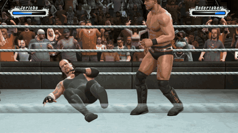
  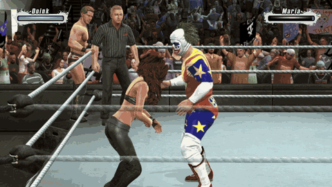
</p>

## Your own entrance music (User Playlist)

Like songs from the Xbox 360's hard drive: inside the `music` folder (next to `svr2009.exe`), make a
folder for each playlist and put your **MP3** files in it. Then, where you choose an entrance's
music, pick **User Playlist** and your playlist.

```
SVR2009-NATIVE\
  svr2009.exe
  music\
    My Theme\
      my song.mp3
```

<details>
<summary><b>More about entrance music</b></summary>

- Songs play in the order of their file names (put `01`, `02`... in front). MP3s placed straight in
  `music` show up as a playlist called **Music**. WAV works too; other formats (M4A, AAC, FLAC, WMA,
  OGG) need converting to MP3 first.
- In the game: create or edit an entrance, choose **User Playlist**, then your playlist by its folder
  name. It plays right away so you can hear it; in matches it plays during the entrance.
- New songs show up the next time you open the playlist list. A renamed folder needs choosing again.
  Songs play from the start, so trim long intros.
- The volume follows the game's, and **Sound: Muted** mutes it too. Updates never touch `music`.
- **Steam Deck:** in Desktop Mode, copy your music into `music` with the file manager (Dolphin).
- **Nothing plays?** The folder needs at least one `.mp3` or `.wav`; `game.log` explains on lines
  starting with `Music:`.

</details>

## Mods

Mods swap some of the game's files for their own: superstars, attires, arenas, menus. Extract them
into the `mods` folder next to `svr2009.exe` and they're in the game, and you switch each one on or
off from inside the game. Your disc image is never changed, and a mod that comes with its own save
plays on saves of its own, so your progress is never touched.

<p align="center">
  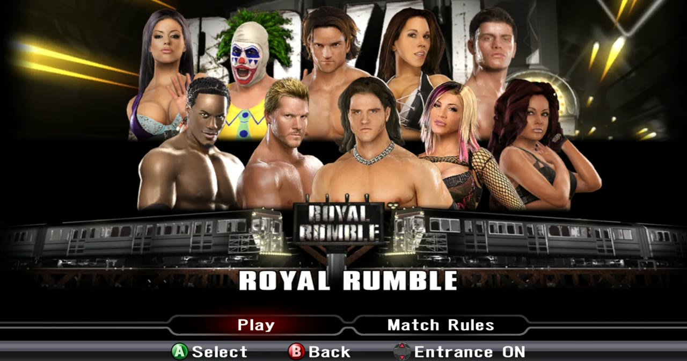
  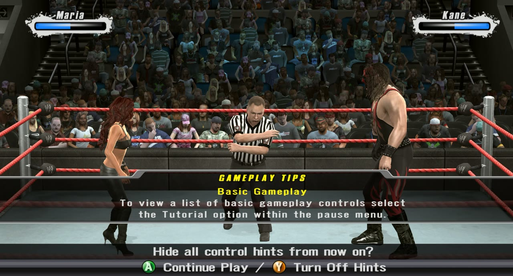
  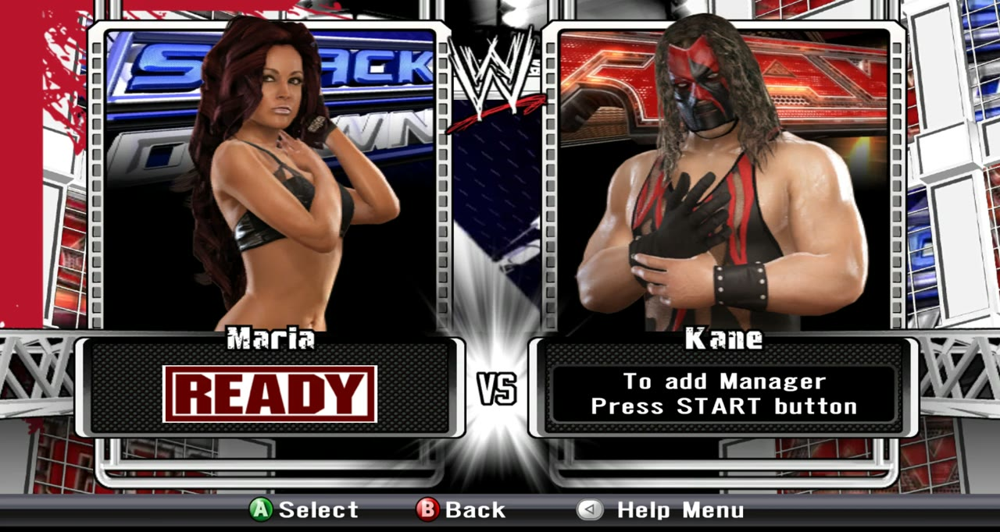
  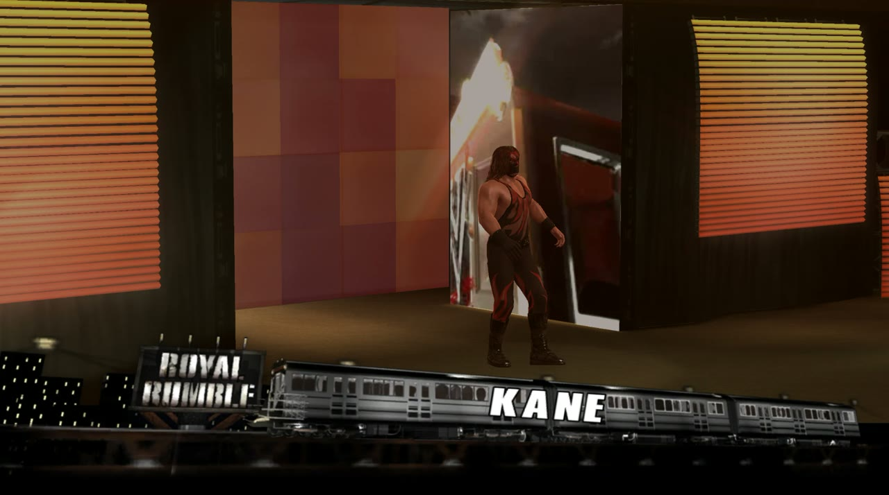
</p>

### SVR09+ by yumboy11, step by step

[SVR09+](https://smacktalks.org/forums/topic/79023-smackdown-vs-raw-2009-mod-xbox-360-version-11-released/)
adds the Godfather (cut DLC), the PS3-only attires, a second playable Hornswoggle and the NPCs, puts
Divas in every match type and the Royal Rumble, and lets anyone hold any title. **Version 1.1**
works here, and you skip the Xbox 360 part of its guide: no xdelta patching, no resigning the save,
no installing the DLC, no unlocking licences. The port does those itself.

**Windows**

1. Update the game to **v3.0 or newer**: **F1** > **Update**, or download the latest zip.
2. Download **SVR09+ 1.1** (`SVR09+_1.1_yumboy11.7z`) from yumboy11's thread on SmackTalks (link
   above).
3. Open the **`mods`** folder next to `svr2009.exe` (in the game: **F5** > **Open mods folder**).
4. **Extract the download into `mods`.** With [7-Zip](https://www.7-zip.org): copy the `.7z` into
   `mods`, right-click it > *7-Zip* > *Extract Here*. On Windows 11 you can also right-click it >
   *Extract All...* and choose the `mods` folder. You now have a folder called
   `SVR09+_1.1_yumboy11`. Delete the `.7z` from `mods` afterwards.
5. **Extract `root.7z` too.** Open the new folder: inside is `root.7z`, the mod's game files.
   Right-click it > *7-Zip* > *Extract Here* (or *Extract All...*), so `pac`, `movies` and
   `plist360.arc` appear in that same folder. The mod's own guide has this step as well.
6. **Start the game.** The corner says **1 mod on**: you're playing SVR09+. On its first start the
   game installs the mod's DLC and copies its save in, once, by itself.

When it's right, it looks like this:

```
SVR2009-NATIVE\
  svr2009.exe
  userdata\                  your own saves (never touched by the mod)
  userdata-mods\             made by the game: saves of mods that bring their own
  mods\
    SVR09+_1.1_yumboy11\
      Content\               the mod's save and DLC (installed by the game itself)
      pac\                   from root.7z
      movies\                from root.7z
      plist360.arc           from root.7z
      plist360_4x3.arc       from root.7z
      Patch.xdelta           built into the port: nothing to do with it
      root.7z
      READ_ME_Install Guide.txt
```

**Steam Deck / Linux**

1. Update the game to v3.0 or newer, then switch to **Desktop Mode**.
2. Download `SVR09+_1.1_yumboy11.7z` and copy it into the game's `mods` folder (for example
   `/home/deck/Games/SVR2009-NATIVE/mods`) with the file manager (Dolphin).
3. Right-click it > *Extract* > *Extract archive here*, then delete the `.7z`.
4. Open the new `SVR09+_1.1_yumboy11` folder, right-click `root.7z` > *Extract* > *Extract archive
   here*.
5. Back in **Game Mode**, start the game as usual.

### Playing with or without a mod

- **F5**, or **Mods** at the top of the settings menu (**F1**, **Back + Start**, **Share + Options**
  on PlayStation, **View + Menu** on the Deck) opens the Mods page: every mod with **On** or
  **Off**. Press **A** or **left/right** to switch one, then **Restart now**: the game starts again
  with the change.
- **To play the original game,** switch the mod **Off** and restart. The roster, the rules and your
  own saves are exactly as they were. Switch it back **On** any time: your modded progress is waiting.
- A mod you add is **On** from the next start. Select it on the Mods page to see what it changes
  (Superstar, Arena, Menu...) and how many of the game's files.

### How your saves are protected

- **A mod gets saves of its own.** A mod that comes with a save or DLC, like SVR09+, plays from its
  own folder, `userdata-mods\<mod name>`, next to your `userdata`. The first time it starts, the
  game installs the mod's DLC there and copies the mod's save in, once. Your own saves, created
  superstars and DLC in `userdata` are not opened, changed or replaced while the mod is on.
- **Switching back is safe.** With the mod **Off**, the game uses `userdata` again, just as you left
  it. Your progress with the mod stays in `userdata-mods` for the next time you switch it on.
- **Your disc image is never changed.** While a mod is on, the game reads the mod's files instead of
  the disc's; nothing is written over your `.iso`.
- **Updates leave all of it alone.** The updater never touches `mods`, `userdata` or
  `userdata-mods`, and before it installs anything it backs up your saves **and** the mods' saves
  to `save_backups`.
- **Removing a mod:** switch it off, or delete its folder from `mods`. Its saves stay in
  `userdata-mods` until you delete them yourself.

<details>
<summary><b>Other mods, and how mods work here</b></summary>

- **Most file mods for the Xbox 360 version work:** extract each into a folder of its own in
  `mods`. Its files replace the game's files with the same path (`pac\ch\ch12.pac`), or with the
  same name when the disc has only one file of that name. Loose `.pac` members (`0014.pac`) are put
  into the right `.pac` by themselves, and the game's `.arc` tables are rebuilt to match.
- **Several mods at once:** they load in alphabetical order; when two replace the same file, the
  later one wins (the Mods page says so). Only one mod's save and DLC are used at a time.
- **Patches of the game's program** (`default.xex`, usually an `.xdelta` file) can't apply, because
  the program is recompiled into `svr2009.exe`; the Mods page says when a mod has one, and the rest
  of the mod still works. SVR09+ 1.1's program changes are built into the port.
- **Files that look made for a different SmackDown game** (arenas, `.pac` members) are left out,
  since they would crash the game, and the Mods page says so.
- **Loose files** straight in `mods` aren't used: a mod needs a folder of its own.
- The game makes a hidden `mods\.cache` folder for the tables it rebuilds; leave it be.

</details>

| What you see | What to do |
|---|---|
| **Can't use**: "it's still packed" | The `.7z` or `.zip` is in `mods` as downloaded: extract it there, then delete the archive. |
| **Can't use**: "its root.7z isn't extracted yet" | Open the mod's folder and extract `root.7z` right there (step 5 above). |
| The mod isn't on the Mods page | It needs a folder of its own inside `mods`; loose files aren't used. |
| Nothing changed in the game | Check the mod is **On** and that you restarted. `game.log` lists what each mod replaced, on lines starting with `Mods:`. |

## Known issues

- **Local multiplayer:** with **Separate players**, if a controller shows up twice (Steam Input,
  DS4Windows, DSX) and the copy drops out, the game pauses for player 2 ("2P paused") until it comes
  back: close or turn off the app making the copy.

## Troubleshooting

| What happens | What to do |
|---|---|
| A window asks for a disc image | There's no `.iso` next to `svr2009.exe`: pick your disc image (it's remembered), or copy it into the game's folder. |
| The game closes right after starting | Check that your disc image is the USA / Europe release of SvR 2009 and complete. |
| Black screen, or the game closes | Update your graphics driver. Still happening: **F1** > *Graphics API* > the other one (or add `svr_graphics_api = "vulkan"` to `svr2009.toml`) and start again. |
| It runs slowly | Get the latest version. **F1** > *CPU priority* > **High** helps on a busy or weak PC; on a weak graphics card, **F1** > *Resolution* > **720p** (from the next start). |

Still stuck? [Open an issue](https://github.com/nefariousjosiah/WWE-SVR2009-RECOMP/issues) with
`game.log` from the game's folder, your processor and graphics card.

<details>
<summary><b>How it works</b></summary>

- **Recompilation.** [ReXGlue](https://github.com/rexglue/rexglue-sdk) translates the game's Xbox 360
  executable into C++ compiled for x86-64. The Xbox 360 system calls it makes are provided by the
  ReXGlue runtime, which also reads the game's data straight from your disc image.
- **Rendering.** Instead of emulating the Xbox 360 GPU, the renderer (adapted from
  [re:Blue](https://github.com/zolaware/reblue)) watches the game's own Direct3D library and draws the
  same scenes through [plume](https://github.com/zolaware/plume) on Direct3D 12 or Vulkan (two builds,
  `svr2009.exe` and `svr2009_vulkan.exe`; under Proton the first starts the second). The game's
  shaders are converted ahead of time with [XenosRecomp](https://github.com/zolaware/reblue-XenosRecomp),
  and the graphics pipelines are compiled in the background while each scene loads.
- **60 fps.** The game has its own 60 fps mode, which it normally drops to 30 for matches; a hook
  keeps it at 60, so the game logic and the animations stay in step.

</details>

<details>
<summary><b>Building from source</b></summary>

For developers; players use the releases. Windows, with about 30 GB free.

```
git clone https://github.com/nefariousjosiah/WWE-SVR2009-RECOMP.git
cd WWE-SVR2009-RECOMP
powershell -ExecutionPolicy Bypass -File tools\windows\setup.ps1 -Iso "D:\path\to\your disc image.iso"
```

`setup.ps1` installs the tools it needs (Git, CMake, Ninja, LLVM clang, Python, 7-Zip, Visual Studio
2022 Build Tools), fetches the third-party sources at the pinned commits and applies this project's
patches (`patches/`), builds the ReXGlue SDK, extracts your disc image to `assets/`, recompiles
`default.xex` and builds the game.

The native renderer also needs your game's shaders, which can't be in this repository. The first
time, `setup.ps1` builds a shader-dump version and tells you how to collect them: play the menus
and a match or two with shader dumping on, run `tools\native\build_shader_cache.ps1`, then run
`setup.ps1` again.

Afterwards: `tools\windows\build.ps1` rebuilds, `tools\windows\run.ps1` runs it, and
`tools\windows\package_release.ps1` makes the release zip (the game, no game files; the version
number comes from `CMakeLists.txt`).

Repository layout: `src/` the game-specific code (`native/` renderer glue, `reblue/` the renderer),
`config/` recompiler configuration, `patches/` changes to the third-party sources, `tools/` build
scripts, `docs/` the images on this page.

</details>

## Credits

- [ReXGlue SDK](https://github.com/rexglue/rexglue-sdk) by Tom Clay, derived from
  [Xenia](https://xenia.jp): the recompiler and runtime.
- [re:Blue](https://github.com/zolaware/reblue) (Blue Dragon), the renderer this one is adapted
  from, with [plume](https://github.com/zolaware/plume) and
  [XenosRecomp](https://github.com/zolaware/reblue-XenosRecomp).
- [Dear ImGui](https://github.com/ocornut/imgui) with the Press Start 2P and Roboto fonts for the
  settings menu; [SDL](https://libsdl.org) for controllers and sound; [zstd](https://github.com/facebook/zstd).
- Inside the runtime: [FFmpeg](https://ffmpeg.org) (audio),
  [libmspack](https://github.com/kyz/libmspack) and the other libraries the ReXGlue SDK uses.

Licences of all of these: [THIRD_PARTY.md](THIRD_PARTY.md).

## Licence and legal

This project's own code, including the native renderer for SmackDown vs. Raw, was written by
nefariousjosiah and is licensed under the GNU General Public License v3.0 ([LICENSE](LICENSE)). The
releases are covered by the same licence, and this repository is their source. It builds on
re:Blue's renderer core (BSD 3-Clause) and the other projects in [THIRD_PARTY.md](THIRD_PARTY.md),
which keep their own licences; the releases include FFmpeg and libmspack under the LGPL (their
source: see THIRD_PARTY.md). None of the files from the game disc are in this repository or the
releases: the game's data (models, textures, sound, video) comes from your own disc image. The
releases do contain the game's program in recompiled form (`svr2009.exe`, with the game's shaders
converted for PC).

WWE, SmackDown vs. Raw and all related names, characters, content and the gameplay shown in the
showcase clips belong to their respective owners (WWE, THQ, Yuke's); the clips are used only to show
the port running. This is an unofficial fan project, not affiliated with or endorsed by them or by
Microsoft.
